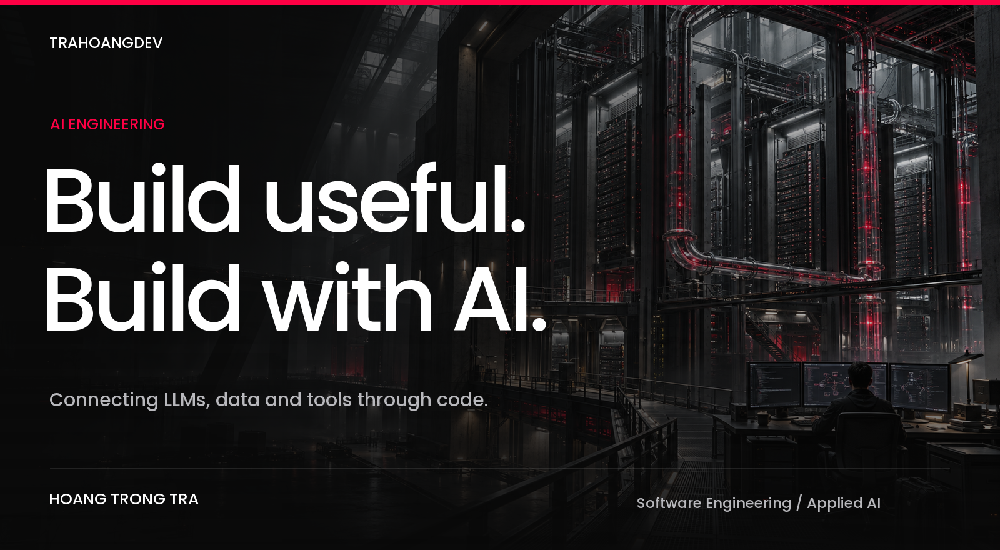
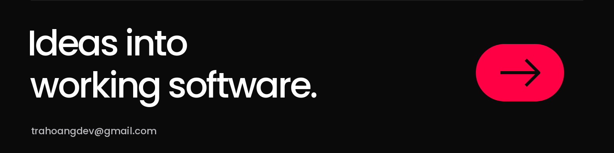

<picture>
  <source media="(max-width: 600px)" srcset="./assets/readme/vvsvs-engineering-hero-mobile.png" />
  
</picture>

# Hoang Trong Tra

**Software Engineering · AI Engineering & Full-stack Development**

 

## Build. Learn. Repeat.

I'm **Tra**, a software engineering student in Ho Chi Minh City, Vietnam, building toward a career in **AI Engineering**.

My foundation is full-stack development. My focus is connecting language models to knowledge, tools, and usable interfaces. I build with TypeScript and Node.js, and I'm developing my Python skills for AI applications.

## From models to applications.

<picture>
  <source media="(max-width: 600px)" srcset="./assets/readme/engineering-flow-mobile.svg" />
  
</picture>

**Retrieval & knowledge** 
Exploring embeddings, vector search, and RAG pipelines that bring relevant context into AI applications.

**Agents & tools** 
Working with LLM APIs and the Model Context Protocol to connect models with backend services and useful actions.

**Evaluation & reliability** 
Learning to evaluate response quality, handle failures, and balance latency and cost.

**End-to-end delivery** 
Bringing AI features into web products through APIs, streaming responses, and interfaces built with React and Next.js.

 

## The toolkit.

| Area | Technologies & concepts |
| :--- | :--- |
| **AI & retrieval** |       |
| **Languages** |     |
| **Backend & data** |     |
| **Frontend** |       |
| **Delivery & quality** |       |

## Notes from the work.

I write about **Next.js, React, and clean code** on [my website](https://trahoangdev.me).

For project conversations and technical discussions: **[trahoangdev@gmail.com](mailto:trahoangdev@gmail.com)**.

 

